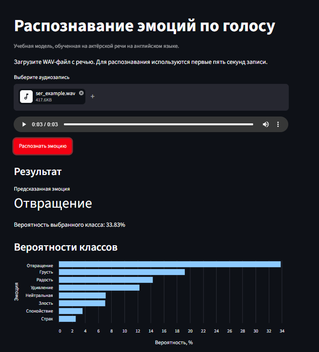
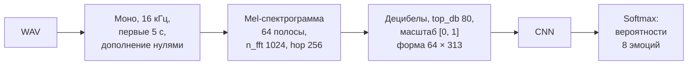
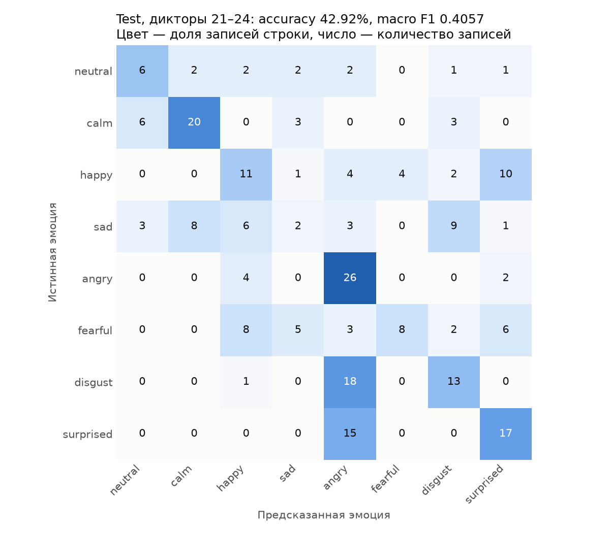
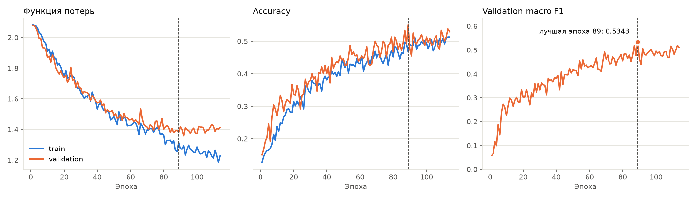

# Speech Emotion Recognition

[](https://github.com/twzuka/speech-emotion-recognition/actions/workflows/ci.yml)

Классификация эмоции, выраженной в речи. На вход подаётся WAV-файл, на выходе получается одна из восьми эмоций и вероятности всех классов. Небольшая свёрточная сеть (2D CNN, около 159 тыс. параметров) работает с log-Mel спектрограммами и обучена на датасете RAVDESS с разбиением по дикторам. Есть командная строка и локальный веб-интерфейс на Streamlit.

Учебный проект ознакомительной практики. Стек: Python 3.11, NumPy, librosa, scikit-learn, TensorFlow/Keras, Streamlit.



*Интерфейс Streamlit. Пример ошибки модели: у записи `Actor_21/03-01-01-01-01-01-21.wav` из test разметка neutral, а модель выбрала «Отвращение» с вероятностью 33.83%.*

## Содержание

- [Пайплайн](#пайплайн)
- [Данные и разбиение по дикторам](#данные-и-разбиение-по-дикторам)
- [Модель](#модель)
- [Результаты](#результаты)
- [Разбор результатов и ограничения](#разбор-результатов-и-ограничения)
- [Быстрый старт](#быстрый-старт)
- [Готовая модель без обучения](#готовая-модель-без-обучения)
- [Запуск в Windows на CPU](#запуск-в-windows-на-cpu)
- [Полный цикл: данные, обучение, оценка](#полный-цикл-данные-обучение-оценка)
- [Проверки](#проверки)
- [Структура проекта](#структура-проекта)
- [Возможные улучшения](#возможные-улучшения)
- [Данные RAVDESS и лицензии](#данные-ravdess-и-лицензии)

## Пайплайн



Одна и та же функция `audio_to_logmel` из [`src/preprocessing.py`](src/preprocessing.py) используется при подготовке данных, в командной строке и в Streamlit. Для одной записи test проверено, что признаки из исходного WAV совпадают с признаками в `test.npz` с допуском `1e-6`.

| Параметр | Значение |
|---|---|
| Частота дискретизации | 16 000 Гц, моно |
| Длительность | первые 5 с; короткие записи дополняются нулями справа |
| Mel-полосы | 64 |
| FFT / шаг окна | 1024 / 256 |
| Логарифмирование | `power_to_db`, `ref=np.max`, `top_db=80` |
| Масштаб признаков | `[0, 1]`, `float32` |
| Форма входа | `(64, 313, 1)` |
| Seed | 42 |

Тишина не удаляется, амплитуда отдельно не нормализуется. Пустые и полностью беззвучные записи отклоняются с понятной ошибкой.

## Данные и разбиение по дикторам

Используется речевая часть [RAVDESS](https://zenodo.org/records/1188976), архив `Audio_Speech_Actors_01-24.zip`: 1440 WAV-файлов, 24 профессиональных актёра (12 мужчин и 12 женщин), английская речь, 48 кГц. Эмоция и номер актёра извлекаются из имени файла.

| Метка | 0 | 1 | 2 | 3 | 4 | 5 | 6 | 7 |
|---|---|---|---|---|---|---|---|---|
| Эмоция | neutral | calm | happy | sad | angry | fearful | disgust | surprised |

| Выборка | Дикторы | Записей | neutral | каждый другой класс | Назначение |
|---|---|---|---|---|---|
| train | 01–16 | 960 | 64 | 128 | обучение весов |
| validation | 17–20 | 240 | 16 | 32 | выбор модели и эпохи |
| test | 21–24 | 240 | 16 | 32 | итоговая оценка |

**Почему разбиение именно по дикторам.** В RAVDESS каждый актёр произносит одни и те же две фразы с каждой эмоцией по несколько раз. При случайном разбиении записи одного человека попадают и в train, и в test. Тогда модель частично узнаёт голос, тембр и манеру конкретного актёра, а не эмоцию, и метрика на test оказывается завышенной. При разбиении по дикторам test состоит только из голосов, которых модель не слышала. Это ближе к реальному применению.

Разбиение закреплено в [`config/splits.json`](config/splits.json). Отсутствие пересечений проверяется на каждом этапе: при создании метаданных, при подготовке NPZ, при загрузке выборок в обучении и перед оценкой.

## Модель

[`src/model.py`](src/model.py), 158 792 параметра, формы указаны без размера пакета:

| Слой | Параметры | Выход |
|---|---|---|
| Вход | одноканальная спектрограмма | 64 × 313 × 1 |
| RandomTranslation | сдвиг до 5% по частоте и 10% по времени, только при обучении | 64 × 313 × 1 |
| Conv2D + MaxPooling2D | 32 фильтра 3 × 3, ReLU / 2 × 2 | 32 × 156 × 32 |
| Conv2D + MaxPooling2D | 64 фильтра 3 × 3, ReLU / 2 × 2 | 16 × 78 × 64 |
| Conv2D + MaxPooling2D | 128 фильтров 3 × 3, ReLU / 2 × 2 | 8 × 39 × 128 |
| AveragePooling2D | окно 1 × 39, усреднение только по времени | 8 × 1 × 128 |
| Flatten | | 1024 |
| Dense | 64, ReLU | 64 |
| Dropout | 0.5 | 64 |
| Dense | 8, Softmax | 8 |

Усреднение идёт только по времени: так модель не зависит от длины фразы, но сохраняет информацию о том, в каких частотных полосах находятся признаки.

**Обучение** ([`src/train.py`](src/train.py), [`config/training.json`](config/training.json)):

- оптимизатор Adam, начальный learning rate 0.001, batch size 32, не больше 150 эпох;
- функция потерь sparse categorical crossentropy;
- веса классов считаются только по train (`--balance-classes`): у neutral 1.875, у остальных 0.9375, потому что записей neutral вдвое меньше;
- после каждой эпохи callback считает macro F1 на всей validation;
- по этой метрике работают `ModelCheckpoint` (сохраняется лучшая эпоха) и `EarlyStopping` (patience 25);
- `ReduceLROnPlateau` следит за validation loss: множитель 0.5, patience 8, минимум 0.00001;
- test скриптом обучения не читается.

Macro F1 выбрана основной метрикой, потому что каждый класс входит в среднее с одинаковым весом. Accuracy при неравных классах может скрыть, что какую-то эмоцию модель почти не распознаёт.

## Результаты

Выбранный запуск: `20261006-190944-469997`. Обучение остановилось после 114 эпох, лучшая эпоха 89.

| Выборка | Правильно | Accuracy | Macro F1 |
|---|---|---|---|
| validation (дикторы 17–20) | 132 / 240 | 55.00% | 0.5343 |
| test (дикторы 21–24) | 103 / 240 | 42.92% | 0.4057 |

Показатели по классам на test ([`classification_report.txt`](reports/20261006-190944-469997/classification_report.txt)):

| Класс | Precision | Recall | F1 | Записей |
|---|---|---|---|---|
| neutral | 0.4000 | 0.3750 | 0.3871 | 16 |
| calm | 0.6667 | 0.6250 | 0.6452 | 32 |
| happy | 0.3438 | 0.3438 | 0.3438 | 32 |
| sad | 0.1538 | 0.0625 | 0.0889 | 32 |
| angry | 0.3662 | 0.8125 | 0.5049 | 32 |
| fearful | 0.6667 | 0.2500 | 0.3636 | 32 |
| disgust | 0.4333 | 0.4062 | 0.4194 | 32 |
| surprised | 0.4595 | 0.5312 | 0.4928 | 32 |

### Матрица ошибок на test



Строки показывают истинную эмоцию, столбцы — предсказанную. Цвет — доля записей строки, нормировка нужна потому, что в neutral 16 записей, а в остальных классах по 32.

### Кривые обучения



Пунктир отмечает лучшую эпоху 89. Train loss считается с весами классов, а validation loss без них, поэтому абсолютные уровни двух кривых напрямую не сравниваются. Train accuracy считается при включённых случайных сдвигах и Dropout, поэтому она близка к validation и не означает отсутствия переобучения.

Графики строятся скриптом [`src/plot_results.py`](src/plot_results.py) из сохранённых `history.csv` и `test_metrics.json`. Модель и датасет для этого не нужны.

### Эксперименты

Test считался для пяти вариантов CNN. В каждом следующем что-то менялось относительно предыдущего. Отличия восстановлены по конфигурациям сохранённых моделей и `run_info.json`; отчёты по test лежат в [`reports/`](reports/).

| № | Запуск | Изменение | Validation macro F1 | Test accuracy | Test macro F1 |
|---|---|---|---|---|---|
| 1 | `20261005-192139-541687` | базовая CNN: GlobalAveragePooling2D, Dropout 0.3, до 60 эпох, patience 10 | 0.4035 | 33.33% | 0.2491 |
| 2 | `20261005-200809-357692` | усреднение только по времени; до 150 эпох, patience 25, ReduceLROnPlateau | 0.4681 | 41.25% | 0.3751 |
| 3 | `20261005-202635-607776` | Dropout 0.5 | 0.4755 | 43.75% | 0.3882 |
| 4 | `20261006-184235-498641` | случайные сдвиги спектрограммы (RandomTranslation) | 0.5278 | 45.83% | 0.3976 |
| 5 | `20261006-190944-469997` | веса классов (`--balance-classes`) | **0.5343** | 42.92% | **0.4057** |

Итоговый вариант выбран по validation macro F1. Если бы выбирали по test accuracy, победил бы вариант 4 (45.83%). Такой выбор был бы подгонкой под test, поэтому он не делался. Промежуточные запуски, для которых test не считался, в таблицу не включены.

## Разбор результатов и ограничения

**Почему test ниже validation (42.92% против 55.00%):**

- **Мало дикторов.** В validation и test всего по 4 актёра, а качество сильно зависит от конкретного голоса. Например, у варианта 4 accuracy по отдельным дикторам validation была от 50.00% до 68.33% ([`validation_check.txt`](reports/20261006-184235-498641/validation_check.txt)).
- **Маленькая выборка.** 240 записей дают стандартную ошибку accuracy около 3 п.п. (√(0.43·0.57/240) ≈ 0.032). Значит, разница отчасти объясняется случайностью.
- **Выбор по validation.** Эпоха, архитектура и параметры подбирались по validation, поэтому оценка на ней оптимистична. Test честнее, хотя и он не полностью «слепой» (см. ниже).

**Какие эмоции путаются** (по матрице ошибок):

- sad почти не распознаётся: верно 2 из 32. Записи уходят в disgust (9), calm (8) и happy (6).
- Модель слишком часто выбирает angry: 71 раз на 32 настоящих записи (recall 0.81, precision 0.37). В angry уходят 18 из 32 записей disgust и 15 из 32 surprised.
- happy путается с surprised (10 из 32), fearful — с happy (8) и surprised (6).
- Лучше всего распознаются angry (26 из 32), calm (20 из 32) и surprised (17 из 32).

Матрица показывает, какие ошибки делает модель на этих данных. Причины ошибок она не объясняет.

**Ограничения:**

- **Test не полностью слепой.** Его смотрели для пяти вариантов CNN. Итоговую модель по test не выбирали, но независимой финальной проверки не было.
- **Данные узкие.** RAVDESS — это актёрская, намеренно выраженная эмоция в английской речи, записанная в студии, и всего две фразы. На естественной речи, других языках, с шумом и другими микрофонами качество не проверялось и не гарантируется.
- **Длинные записи обрезаются.** Используются только первые 5 секунд записи.
- **Вероятности не откалиброваны.** Softmax отражает выход модели для конкретной записи, калибровка не проверялась.
- **Распознаётся выраженная эмоция.** Модель классифицирует эмоцию, выраженную в записи, а не внутреннее состояние человека.

## Быстрый старт

Проверенная среда: WSL2 Ubuntu 26.04, Python 3.11.16, TensorFlow 2.21.0, Keras 3.15.1, Streamlit 1.64.0, NVIDIA RTX 4070. Нужен [uv](https://docs.astral.sh/uv/). Для обучения нужны драйвер NVIDIA с поддержкой WSL2 и GPU, а предсказание и интерфейс работают и на CPU.

```bash
git clone https://github.com/twzuka/speech-emotion-recognition.git
cd speech-emotion-recognition

uv python install 3.11.16
uv venv --python 3.11.16
uv pip sync --python .venv/bin/python requirements.txt
uv pip check --python .venv/bin/python
```

Активировать окружение и пути к библиотекам CUDA нужно в каждом новом терминале:

```bash
source activate_gpu.sh
python -c "import tensorflow as tf; print(tf.config.list_physical_devices('GPU'))"
```

Прямые зависимости перечислены в [`requirements.in`](requirements.in), точные версии закреплены в [`requirements.txt`](requirements.txt). Пакет `tensorflow[and-cuda]` ставится только в Linux. Для Windows есть отдельный набор, см. [ниже](#запуск-в-windows-на-cpu).

Все команды выполняются из корня проекта.

## Готовая модель без обучения

Веса в Git не хранятся. Чтобы запустить предсказание и интерфейс без обучения, скачайте `best.keras` и `run_info.json` со страницы [релиза v1.0.0](https://github.com/twzuka/speech-emotion-recognition/releases/tag/v1.0.0) и положите их в `models/20261006-190944-469997/`:

```bash
mkdir -p models/20261006-190944-469997
curl -L -o models/20261006-190944-469997/best.keras https://github.com/twzuka/speech-emotion-recognition/releases/download/v1.0.0/best.keras
curl -L -o models/20261006-190944-469997/run_info.json https://github.com/twzuka/speech-emotion-recognition/releases/download/v1.0.0/run_info.json
sha256sum models/20261006-190944-469997/*
```

Ожидаемые контрольные суммы SHA-256:

```text
2ee1466f1abc2d55e0b277da583d7699315973c3ed77f4bf38ec4d725ba01fd0  best.keras
0114dea7f1b6205f7942e718a6a707648a504fd52f23b44f0d9487c709a3ba4b  run_info.json
```

Распознавание одного файла (используются первые пять секунд):

```bash
python -m src.predict --run-dir models/20261006-190944-469997 --audio path/to/speech.wav
```

Скрипт выводит эмоцию и вероятности всех восьми классов. При загрузке проверяется, что обучение запуска завершено, что настройки в `config/settings.json` совпадают с сохранёнными в `run_info.json` и что формы входа и выхода совпадают с ожидаемыми.

Интерфейс Streamlit:

```bash
python -m streamlit run app.py --server.address 127.0.0.1
```

Откройте <http://127.0.0.1:8501>, загрузите WAV и нажмите «Распознать эмоцию». Каталог модели задан константой `RUN_DIR` в [`app.py`](app.py). Повреждённые файлы и тишина обрабатываются с сообщением об ошибке, а загруженный файл удаляется после обработки.

## Запуск в Windows на CPU

Для Windows 11 без WSL и GPU есть отдельный набор зависимостей [`requirements-windows.txt`](requirements-windows.txt): только инференс и Streamlit, без CUDA и инструментов обучения. Кратко:

```powershell
py -3.11 -m venv .venv
.\.venv\Scripts\python.exe -m pip install --only-binary=:all: -r requirements-windows.txt
.\.venv\Scripts\python.exe check_model.py
.\.venv\Scripts\python.exe -m streamlit run app.py --server.address 127.0.0.1
```

Нужен Python 3.11 x64, с Python 3.14 этот набор не работает. Перед запуском положите модель в `models\20261006-190944-469997\`. [`check_model.py`](check_model.py) проверяет контрольные суммы модели и одно вычисление на CPU. Подробная инструкция, включая готовый архив из релиза, — в [`WINDOWS.md`](WINDOWS.md).

## Полный цикл: данные, обучение, оценка

### 1. Датасет

Скачайте `Audio_Speech_Actors_01-24.zip` со [страницы RAVDESS на Zenodo](https://zenodo.org/records/1188976) в `data/raw/` и проверьте архив:

```bash
mkdir -p data/raw
printf '%s\n' 'bc696df654c87fed845eb13823edef8a  data/raw/Audio_Speech_Actors_01-24.zip' | md5sum -c
python -m zipfile -e data/raw/Audio_Speech_Actors_01-24.zip data/raw/ravdess
find data/raw/ravdess -type f -name '*.wav' | wc -l
```

Ожидается `OK` и `1440`.

### 2. Подготовка данных

```bash
python -m src.create_metadata
python -m src.analyze_data
python -m src.prepare_data
```

Результаты:

- `data/processed/metadata.csv`;
- `reports/figures/train_data_overview.png`;
- `data/processed/{train,validation,test}.npz` — признаки `X`, метки `y`, дикторы, пути и снимок настроек предобработки.

### 3. Обучение

```bash
python -m src.train --balance-classes
```

Для обучения нужен GPU. Каждый запуск создаёт каталог `models/<run_id>/` с файлами `best.keras`, `history.csv` и `run_info.json`. Новый запуск даст другой `run_id`, а его метрики могут отличаться от приведённых выше.

### 4. Оценка и графики

```bash
python -m src.evaluate --run-dir models/20261006-190944-469997
python -m src.diagnose_validation --run-dir models/20261006-190944-469997
python -m src.plot_results
```

`evaluate` сохраняет `test_metrics.json`, `classification_report.txt` и `confusion_matrix.png` в `reports/<run_id>/`. `diagnose_validation` выводит метрики на train и validation и accuracy по дикторам validation. У всех скриптов есть `--help`.

## Проверки

```bash
python -m pytest -q
ruff check .
ruff format --check .
```

21 тест проверяет:

- конфигурацию: восемь уникальных эмоций, все дикторы 01–24 без повторов;
- предобработку на синтетических WAV: форму `64 × 313`, тип, диапазон `[0, 1]`, перевод стерео в моно, дополнение нулями, использование только первых 5 секунд, детерминированность, отказ на тишине;
- разбор имён файлов RAVDESS: эмоцию, актёра, выборку, отказ на видео, пении, неизвестной эмоции и неизвестном дикторе;
- проверку разбиения: «утечку» диктора из validation в train и повторяющиеся пути.

Тестам не нужны ни TensorFlow, ни датасет, ни GPU. В GitHub Actions ([`.github/workflows/ci.yml`](.github/workflows/ci.yml)) они запускаются вместе с ruff на CPU.

Обучение, модель и интерфейс автоматически не тестируются. Вручную проверены:

- сохранение и загрузка модели;
- предсказание из командной строки и в Streamlit;
- обработка повреждённого WAV и записи с тишиной;
- работа интерфейса после ошибки.

## Структура проекта

```text
.
├── app.py                      # интерфейс Streamlit
├── check_model.py              # проверка модели и инференса на CPU (Windows)
├── activate_gpu.sh             # активация окружения и путей CUDA в WSL
├── config/
│   ├── settings.json           # предобработка, порядок эмоций, seed
│   ├── splits.json             # дикторы train / validation / test
│   └── training.json           # параметры обучения
├── src/
│   ├── create_metadata.py      # metadata.csv по именам файлов RAVDESS
│   ├── analyze_data.py         # распределение классов и длительностей train
│   ├── preprocessing.py        # WAV -> log-Mel (общая функция)
│   ├── prepare_data.py         # NPZ-файлы выборок
│   ├── model.py                # архитектура CNN
│   ├── train.py                # обучение, macro F1 на validation, сохранение
│   ├── evaluate.py             # оценка на test
│   ├── diagnose_validation.py  # метрики train / validation, accuracy по дикторам
│   ├── predict.py              # класс EmotionPredictor и CLI
│   └── plot_results.py         # кривые обучения и матрица ошибок
├── tests/                      # pytest: конфигурация, предобработка, данные
├── reports/                    # метрики и отчёты всех пяти вариантов
├── docs/                       # изображения для README
├── requirements.in / .txt      # зависимости для Linux / WSL
├── requirements-windows.in / .txt
├── WINDOWS.md                  # запуск в Windows на CPU
└── pyproject.toml              # настройки ruff и pytest
```

Датасет (`data/`), окружение (`.venv/`) и модели (`models/`) в Git не входят.

## Возможные улучшения

Ниже перечислены идеи, которые в проекте не реализованы:

- **Кросс-валидация по дикторам.** Например, 6 фолдов по 4 актёра вместо одного разбиения, чтобы оценить разброс метрик.
- **Независимая финальная проверка** на другом корпусе, например CREMA-D, или на дикторах, которых не было ни в одном эксперименте.
- **Аугментации:** SpecAugment (маскирование частот и времени), добавление шума, изменение темпа и высоты голоса.
- **Предобученные аудиомодели:** эмбеддинги wav2vec 2.0, HuBERT или YAMNet вместо обучения CNN с нуля.
- **Калибровка вероятностей:** диаграмма надёжности, temperature scaling.
- **Сохранение предсказаний** по каждой записи test в `evaluate.py` для подробного разбора ошибок.
- **Интерфейс:** запись с микрофона, отображение спектрограммы, обработка длинных записей окнами.

## Данные RAVDESS и лицензии

Код распространяется по лицензии [MIT](LICENSE).

Датасет RAVDESS распространяется по лицензии [CC BY-NC-SA 4.0](https://creativecommons.org/licenses/by-nc-sa/4.0/) и в репозиторий не входит. Веса модели обучены на RAVDESS, поэтому использовать их следует на тех же условиях, то есть некоммерчески и с указанием авторства.

Livingstone S. R., Russo F. A. The Ryerson Audio-Visual Database of Emotional Speech and Song (RAVDESS): A dynamic, multimodal set of facial and vocal expressions in North American English // PLOS ONE. 2018. Vol. 13, № 5. e0196391. DOI: [10.1371/journal.pone.0196391](https://doi.org/10.1371/journal.pone.0196391).

Датасет: [doi.org/10.5281/zenodo.1188976](https://doi.org/10.5281/zenodo.1188976).
